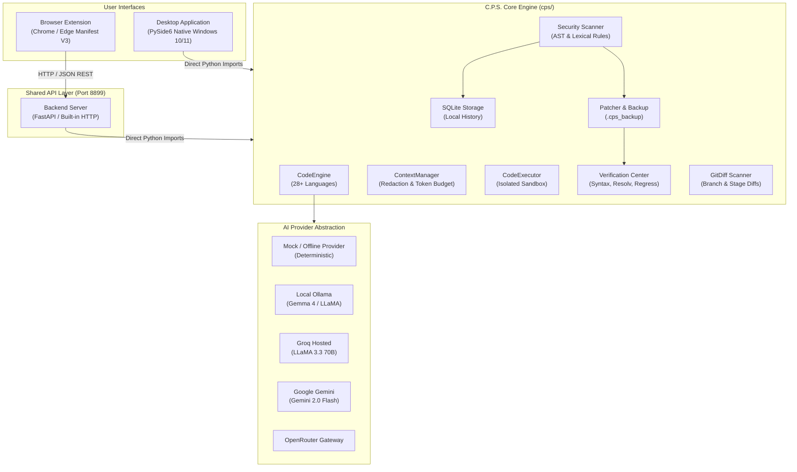

# C.P.S. — Software Architecture Document

## 1. System Overview

C.P.S. (Code Processing System) is architected around a **Shared Core & Dual Client** paradigm. Both the **Windows Desktop Application** and the **Manifest V3 Browser Extension** leverage a unified code generation, security analysis, and execution framework.

---

## 2. Component Specifications

### 2.1 Core Package (`cps/`)
- `ai_provider.py`: Implements `BaseProvider` with concrete adapters for `MockProvider`, `OllamaProvider`, `GroqProvider`, `GeminiProvider`, and `OpenRouterProvider`. Robust JSON parsing, rate-limit retries, and markdown extraction.
- `code_engine.py`: Central multi-language generation engine. Maintains metadata profiles for 28+ languages, parses code blocks, and dispatches generation, explanation, debugging, optimization, conversion, testing, and complexity requests.
- `context_manager.py`: Aggregates contextual snippets from selections, pasted code, active files, and compiler errors. Enforces token budgets and runs automated secret redaction before transmission.
- `executor.py`: Subprocess execution sandbox for Python, JavaScript (Node.js), C, C++, Go, Rust, and Java. Enforces 10-second default timeouts, separate stdout/stderr capture, and tempdir isolation.
- `scanner.py` & `rules.py`: Deterministic AST security scanner checking for SQL injection, command execution, hardcoded credentials, unsafe deserialization, XXE, broken cryptography, and insecure configurations.
- `patcher.py` & `verification.py`: Computes unified diffs, enforces human approval, stores pristine backups in `.cps_backup/`, and runs independent verification across syntax, target resolution, and public API preservation.
- `git_diff.py`: Subprocess Git diff integration identifying newly introduced findings vs pre-existing issues.

### 2.2 Shared Backend API (`backend/`)
- REST API server running on port `8899`.
- Dual architecture: Serves as a full FastAPI application when FastAPI is installed, and seamlessly falls back to a zero-dependency Python `http.server` implementation when dependencies are minimal.
- Comprehensive endpoints: `/api/health`, `/api/languages`, `/api/providers`, `/api/query`, `/api/generate`, `/api/explain`, `/api/debug`, `/api/scan`, `/api/execute`, `/api/runtimes`, `/api/history`, `/api/settings`.

### 2.3 Browser Extension (`extension/`)
- Built for Chrome and Microsoft Edge using Manifest V3.
- `background.js`: Service worker managing context menus, side panel toggles, and backend HTTP proxying.
- `content.js`: Non-intrusive highlight-to-ask floating action button inside a closed Shadow DOM.
- `site_adapters/adapters.js`: Specialized DOM extractors for LeetCode, HackerRank, Codeforces, CodeChef, GeeksforGeeks, GitHub, GitLab, and Stack Overflow.
- `sidebar/`: Full multi-tab side panel (Chat, Code Studio, History, Settings).
- `popup/`: Quick-action launcher.

### 2.4 Windows Desktop Application (`desktop/` & `app.py`)
- Native Windows 10/11 interface built with PySide6.
- 13 pages supporting the complete software development and security review lifecycle.
- Offline-ready with local Ollama support.
