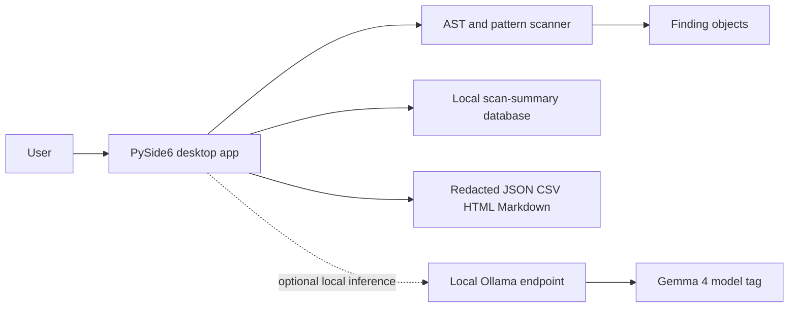

# Architecture

The native entry point is `app.py`. Core analysis, report, storage, provider, patch, and verification modules remain under `vulnquest/`. See [AUDIT.md](AUDIT.md): the patch approval workflow, interactive assistant, Git diff UI, and desktop verification UI are not complete. Legacy hosted provider code exists but is not selected by the desktop app.
